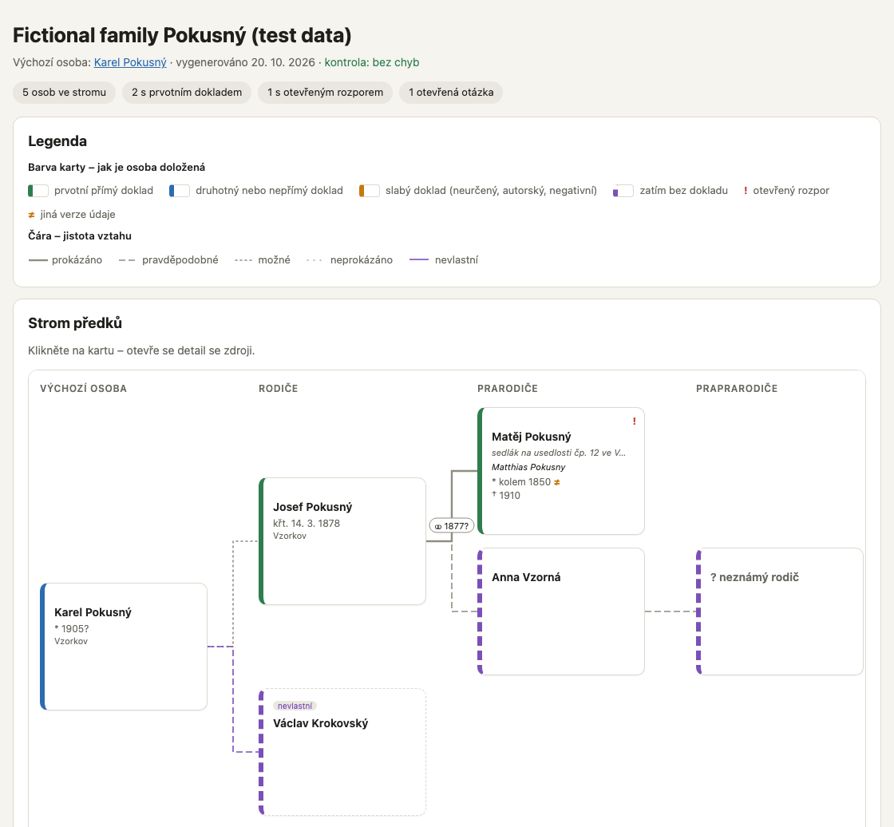
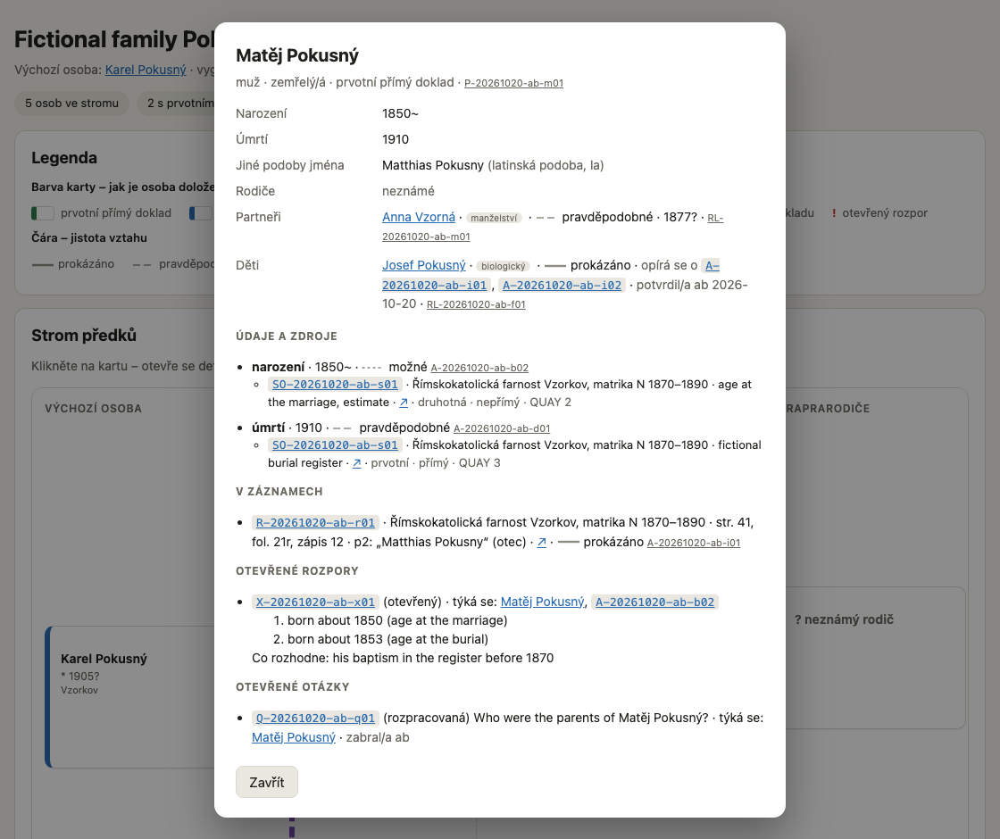

<!-- source: README.md @ v0.3.0 -->
<p align="center">
  <picture>
    <source media="(prefers-color-scheme: dark)" srcset="brand/proavus-logo-dark.svg">
    
  </picture>
</p>

<p align="center"><a href="README.md">English</a> · <b>Čeština</b></p>

**Proavus** – rodokmen s AI podle důkazů, ne odhadů: metodika, datové schéma
a nástroje pro bádání s LLM podle Genealogical Proof Standardu.

> **Rozpracováno (0.3.0).** Existuje schéma, validátor, závazná pravidla
> a první příkazy (`/proavus:init`, `/proavus:start`, `/proavus:end`);
> průvodce instalací (`/setup`) zatím ne. Zatím není k běžnému použití.

## Jak to bude fungovat

1. Založte si účet na GitHubu a nainstalujte desktopovou aplikaci Claude.
2. Požádejte Clauda o nastavení Proavus – vše doinstaluje a založí vám vlastní
   **soukromé** repo rodiny. Nikdy nezapisujte data rodiny do forku Proavus:
   forky jsou veřejné.
3. Otevřete své soukromé repo a napište `/proavus:start`.
4. Popište, koho hledáte; Claude s vámi sestaví otázku a plán a provede vás
   čtením zápisů.
5. Napište `/proavus:end`: výsledky se uloží s citacemi zdrojů a zkontrolují.

## Instalace pluginu z místní složky

Dokud Proavus není veřejný, instaluje se plugin z místní kopie tohoto repa:
repo je samo sobě katalogem pluginů (`.claude-plugin/marketplace.json`,
plugin je celé repo, ADR 0014). Je potřeba Claude Code 2.1.275 nebo novější
(`claude --version`). Desktopová aplikace (karta Code) i příkaz `claude`
v terminálu sdílejí stejné nastavení, takže stačí nainstalovat jednou na
počítač – v terminálu.

1. **Stáhněte framework** do složky mimo iCloud Drive, Dropbox, OneDrive
   nebo Google Drive, např.
   `git clone https://github.com/petrbelohlavek/proavus.git ~/Documents/Proavus/proavus`
   (zatím soukromé – potřebujete přístup).
2. **Přidejte katalog a nainstalujte plugin:**
   ```
   claude plugin marketplace add ~/Documents/Proavus/proavus
   claude plugin install proavus@proavus
   ```
3. **Zkontrolujte instalaci:**
   - `claude plugin list` ukáže `proavus@proavus`, `Status: ✔ enabled`;
   - `claude plugin details proavus@proavus` ukáže `Skills (3)  end, init, start`.
4. **Zkontrolujte příkazy v sezení.** Sezení spuštěná před instalací plugin
   nevidí – začněte nové:
   - **terminál:** spusťte `claude` v libovolné složce a napište `/proavus:` –
     nabídka ukáže `/proavus:init`, `/proavus:start` a `/proavus:end`;
   - **desktopová aplikace:** otevřete nové sezení na kartě Code a do pole
     zprávy napište `/proavus:` – objeví se stejné tři příkazy.

   Rychlá kontrola, která nic nemění: v prázdné složce spusťte
   `claude -p "/proavus:start" --permission-mode plan` – Proavus odpoví, že
   složka zatím není repo rodiny, a nabídne `/proavus:init`.
5. **Založte repo rodiny** příkazem `/proavus:init` (v novém sezení ve
   složce, kde má být). Ten také zakáže nástrojům Claude Code pro úpravu
   souborů sahat z repa rodiny do složky frameworku (tamní
   `.claude/settings.local.json`).

**Aktualizace** po `git pull` ve složce frameworku:
`claude plugin marketplace update proavus`, potom
`claude plugin update proavus@proavus` (převezme nové číslo verze z
`.claude-plugin/plugin.json`) a nové sezení.
**Odebrání:** `claude plugin uninstall proavus@proavus` a
`claude plugin marketplace remove proavus`.

Nástroje běží přímo z této složky (`${CLAUDE_PLUGIN_ROOT}` je sama složka)
a Claude Code ji navíc kopíruje – i se soubory, které git ignoruje – do své
mezipaměti pluginů. Ve složce frameworku nemějte nic soukromého.

## Používání příkazů

Příkazy se píšou do pole zprávy v sezení Claude Code (desktopová aplikace
nebo `claude` v terminálu): napište `/proavus:` a vyberte. Rozhoduje,
**ve které složce sezení běží** – je vidět pod polem zprávy.

| Příkaz | Kdy | Kde | Co dělá |
|---|---|---|---|
| `/proavus:init` | jednou | nové sezení ve složce, kde má repo rodiny vzniknout, nebo v jeho prázdném klonu | založí **soukromé** repo rodiny ze šablony, nainstaluje `.proavus/`, ochrání framework před úpravami, nahraje repo na GitHub a ověří, že je soukromé |
| `/proavus:start` | první zpráva každého sezení bádání | sezení v repu rodiny | kontrola soukromí, stažení práce ostatních, přehled (`START-HERE.md`), výběr nebo zápis výzkumné otázky |
| `/proavus:end` | poslední zpráva každého sezení bádání | totéž sezení | záznam sezení s dalším krokem, rozhodnutí, která dělá jen člověk, validace (0 chyb), uložení na GitHub |
| `/proavus:upgrade` | když `/proavus:start` hlásí, že kopie Proavus je starší než plugin | sezení v repu rodiny, bez neuložených změn | ukáže, co se změní, zeptá se na nová nastavení (např. výchozí osobu mapy), aktualizuje `.proavus/`, bloky Proavus, kontrolní workflow a `schema_version`, při potřebě převede data, zvaliduje a uloží |

Nikdy ve složce frameworku `proavus`: `/proavus:start` a `/proavus:end` se
tam zastaví, `/proavus:init` odmítne složku, která není prázdná. Zapomněli
jste? `/proavus:start` jde spustit kdykoli; po vynechaném `/proavus:end`
otevřete sezení ve složce rodiny a spusťte ho – práce je pořád v souborech,
jen ještě není uložená. Podrobnosti pro členy rodiny jsou v README repa
rodiny.

## Mapa rodiny

`tools/build_views.py` vytvoří z repa rodiny jednu soběstačnou stránku HTML:
funguje offline, nic nenačítá z internetu a do gitu se neukládá. Ukázka je
z fiktivní testovací rodiny v `tests/fixtures/family/`. Barva karty ukazuje,
jak je osoba doložená, čára, jak jistý je vztah.

<p align="center"></p>

Kliknutím na kartu se otevře detail se všemi údaji, jejich jistotou a zdrojem:

<p align="center"></p>

## Co tu je

| Část | Kde |
|---|---|
| Deset závazných pravidel | [method/rules.cs.md](method/rules.cs.md) |
| Čtení zápisů | [method/reading-records.md](method/reading-records.md) (anglicky) |
| Datové schéma v0 | [schema/](schema/README.md) |
| Validátor | `uv run tools/validate.py <repo-rodiny>` |
| Mapa rodiny | `uv run tools/build_views.py <repo-rodiny>` → `views/mapa.html` |
| Architektura a rozhodnutí | [docs/architecture.md](docs/architecture.md), [docs/decisions/](docs/decisions/) |

## Licence

| Část | Licence |
|---|---|
| Metodika a dokumentace (`method/`, `docs/`, `regions/`, README) | CC BY 4.0 |
| Kód (`tools/`, `tests/`, hooky, workflow) | MIT |
| Schéma, slovníky, šablona repa rodiny | CC0 1.0 |
| Název a logo (`brand/`) | všechna práva vyhrazena |

Podrobnosti v [`REUSE.toml`](REUSE.toml) a [`LICENSES/`](LICENSES/).
© 2026 Petr Bělohlávek a přispěvatelé Proavus.
