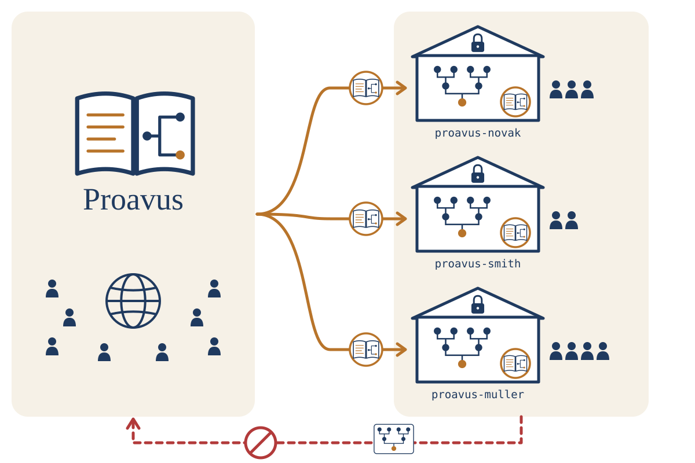

  <picture>
    <source media="(prefers-color-scheme: dark)" srcset="brand/proavus-logo-dark.svg">
    
  </picture>

<b>English</b> · <a href="README.cs.md">Čeština</a> 
<b>For everyone</b> · <a href="TECHNICAL.md">Technical</a>

**Proavus helps you find your ancestors in old parish registers together
with Claude – honestly, with a source for every fact, and your family's data
stay with your family.**

> **Not available to everyone yet.** Proavus is being tested by its first
> families. This page describes how it will work; the
> [technical guide](TECHNICAL.md) has today's state.

## What it does for you

- You tell Claude, in your own words, whom you are looking for – a
  great-grandfather, the village the family came from, a name in an old
  letter.
- Claude helps you find the right register books in the archives' online
  portals and reads the old handwriting **together with you**.
- Only what a record proves goes into your family tree, and every fact
  keeps its source: which book, which page, which entry. Guesses stay
  marked as guesses.
- Nothing is forgotten between sessions: what was searched, what was found
  and what to do next is written down.

## How it fits together

  <picture>
    <source media="(prefers-color-scheme: dark)" srcset="docs/images/proavus-architecture-dark.svg">
    
  </picture>

**One Proavus for everyone, each family on its own.** Proavus – the method
and tools for research – is public and improves for everyone. Each family
takes its own copy into a private repository (such as `proavus-novak`) that
only the family can see. Your family tree and your relatives' data never go
to the public side.

## What you need

- a computer with Windows or macOS;
- a free account on [GitHub](https://github.com) – your family's research is
  kept there, privately;
- the [Claude desktop app](https://claude.ai/download) with a paid plan
  (Pro or higher).

You do not need to know anything about programming. Claude installs
everything else and asks you before every step.

## Getting started

1. Create your GitHub account and install the Claude app.
2. Open the Claude app, go to the **Code** tab, start a new session and
   write: *"Set up Proavus for me."* Claude guides you through the rest:
   it installs what is needed, logs you in to GitHub in your browser and
   creates your family's private repository.
3. Every research session starts with **`/proavus:start`** – Claude shows
   where you stopped last time and what to do next.
4. Tell Claude whom you are looking for, and read the records together.
5. Every session ends with **`/proavus:end`** – the findings are checked
   and saved with their sources.

**Never type a password or a code from GitHub into the chat.** Passwords
belong only in GitHub's own page in your browser.

## A family member joins

Research is better together. Whoever looks after the family's repository
invites the others on GitHub. A new member installs the Claude app and types
**`/proavus:setup`** – Claude installs what is needed, logs them in and adds
them to the family's research. Turn on two-step login on GitHub for
everyone: the repository holds data about living relatives.

## Your data stay yours

- Your family's research is in **your own private repository**; only the
  people you invite can see it.
- For living relatives only the name, birth and family links are kept – for
  children not even the birth date.
- Proavus never publishes anything. Sharing the family map outside the
  family hides the living automatically.

## What you get

A family map you open in any browser: every person, how well each fact is
proven, and where it comes from. Below is the map of a made-up test family.

## Want to know more?

- [Technical guide](TECHNICAL.md) – installing by hand, all commands, tools
  and the data format
- [The ten rules of Proavus](method/rules.md) – how the research is done
- [Licence](TECHNICAL.md#licence) – the method and the tools are free to use

© 2026 Petr Bělohlávek and Proavus contributors.
