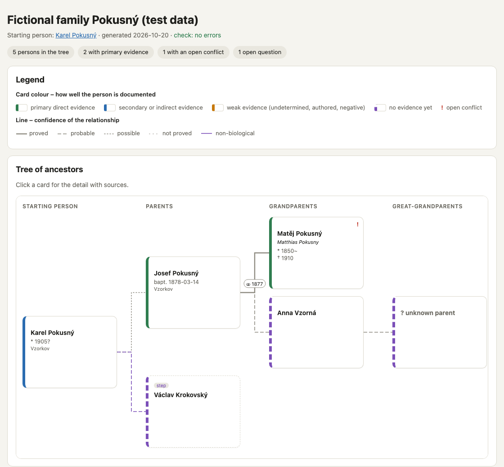
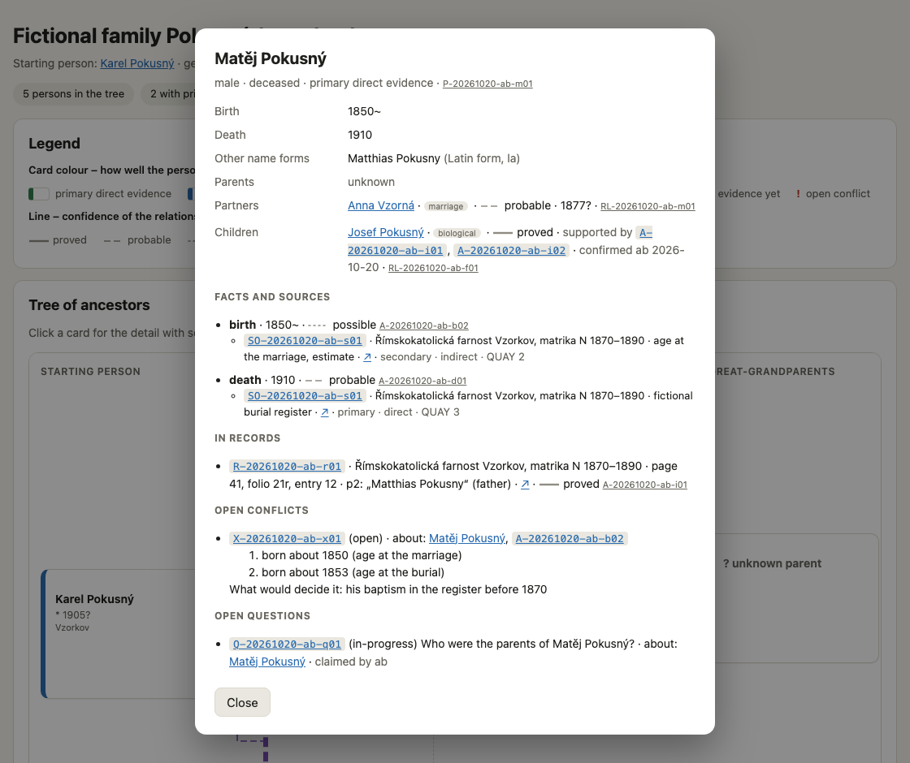

<p align="center">
  <picture>
    <source media="(prefers-color-scheme: dark)" srcset="brand/proavus-logo-dark.svg">
    
  </picture>
</p>

<p align="center"><a href="README.md">For everyone</a> · <b>Technical</b> &nbsp;|&nbsp; English only – <a href="README.cs.md">Čeština pro každého</a></p>

# Proavus – technical guide

For those who install Proavus by hand, help their family with it or develop
it. Everyone else starts with the [README](README.md): the guide
`/proavus:setup` does the steps below for them.

**Proavus** – evidence-first genealogy with AI: a method, a data schema and
tools for researching your family history with an LLM under the
Genealogical Proof Standard. Two kinds of repositories (ADR 0001): this
public framework, and one **private** family repository per family
(`proavus-<family>`) with a pinned copy of the tools in `.proavus/`
(ADR 0014). Never put family data in a fork of Proavus: forks are public.

> **Work in progress (0.7.2).** The schema, the validator, the binding rules
> and the commands (`/proavus:init`, `/proavus:setup`, `/proavus:start`,
> `/proavus:registers`, `/proavus:end`, `/proavus:upgrade`) exist. Not ready for general use.

## Install the plugin from a local folder

Until Proavus is public, the plugin is installed from a local copy of this
repository: the repository is its own plugin catalogue
(`.claude-plugin/marketplace.json`, the whole repository is the plugin, ADR
0014). Needs Claude Code 2.1.275 or later (`claude --version`). The desktop
app (Code tab) and the `claude` command in a terminal share the same
settings, so you install once per computer – in a terminal.

**Claude Code installs whatever is checked out in that folder.** Use the
`stable` branch – the last release. `main` is work in progress (only for
developing Proavus).

1. **Get the framework** (the `stable` branch) into a folder outside iCloud
   Drive, Dropbox, OneDrive or Google Drive, e.g.
   `git clone --branch stable https://github.com/petrbelohlavek/proavus.git ~/Documents/Proavus/proavus`
   (private for now – you need access).
2. **Add the catalogue and install the plugin:**
   ```
   claude plugin marketplace add ~/Documents/Proavus/proavus
   claude plugin install proavus@proavus
   ```
3. **Check what is installed.** `claude plugin list` and `claude plugin
   details` read the framework folder, not the installed copy – they show the
   folder's version even when an older copy is installed. The installed
   version and commit are in Claude Code's own list:
   ```
   python3 -c "import json,os; e=json.load(open(os.path.expanduser('~/.claude/plugins/installed_plugins.json')))['plugins']['proavus@proavus'][0]; print(e['version'], e['gitCommitSha'][:7])"
   git -C ~/Documents/Proavus/proavus log -1 --format=%h
   ```
   Both lines must show the same commit (and the version from
   `CHANGELOG.md`).
4. **Check the commands in a session** – this is what counts. Sessions
   started before the installation do not see the plugin – restart the
   desktop app or start a new session:
   - **terminal:** run `claude` in any folder and type `/proavus:` – the
     suggestions offer `/proavus:init`, `/proavus:setup`,
     `/proavus:start`, `/proavus:registers`, `/proavus:end` and
     `/proavus:upgrade`;
   - **desktop app:** open a new session in the Code tab and type `/proavus:`
     in the message box – the same six commands appear.

   A quick check that changes nothing: in an empty folder run
   `claude -p "/proavus:start" --permission-mode plan` – Proavus answers that
   the folder is not a family repository yet and offers `/proavus:init`.
5. **Create your family repository** with `/proavus:init` (in a new session
   in the folder where it should live). It also forbids Claude Code's
   file-editing tools to touch the framework folder from the family
   repository (`.claude/settings.local.json` there).

## A family member joins (`/proavus:setup`)

The maintainer invites the member to the private family repository (GitHub →
repository → Settings → Collaborators) and, while Proavus is private, to
`petrbelohlavek/proavus` too. The member creates a GitHub account, installs
the Claude desktop app and, in a new session in the Code tab (any folder,
e.g. Documents), writes:

> Set up Proavus for me: install git and the GitHub CLI, log me in to GitHub
> in the browser, download https://github.com/petrbelohlavek/proavus (branch
> `stable`) into `Documents/Proavus/proavus` and follow
> `skills/setup/SKILL.md` in it. My family repository is
> `<owner>/proavus-<family>`.

On a computer where the plugin is already installed, `/proavus:setup` is
enough. The guide asks before every step and skips what is done, so it can
be run again after a restart:

1. git, `gh` and `uv` (macOS: Homebrew, or the system installers; Windows:
   `winget`);
2. GitHub login in the browser (`gh auth login --web`, `gh auth setup-git`)
   and the advice to turn on two-factor login;
3. the plugin from the catalogue (the `stable` branch, as above);
4. checks that the family repository is private and what the account may do
   (`tools/family_repo.py access`), then clones it;
5. adds the member to `repo.yaml` – abbreviation, name, role (researcher,
   helper, maintainer) – with a commit (admin, maintain) or a pull request
   for the maintainer (write);
6. hands over to `/proavus:start` in the family folder.

Every commit in a family repository is checked first: `.githooks/pre-commit`
runs the validator on what is being saved and stops a commit with errors
(ADR 0049); `/proavus:setup`, `/proavus:start` and `/proavus:upgrade`
switch it on in each clone.

**Never type a password, a token or a recovery code into the chat** – the
password goes only into GitHub's page in the browser or into a system window.

## Update to a new release

```
git -C ~/Documents/Proavus/proavus pull
claude plugin marketplace update proavus
claude plugin uninstall proavus@proavus
claude plugin install proavus@proavus
```
then check as in step 3 and restart the desktop app (or start a new
session); in each family repository run `/proavus:upgrade`.
`claude plugin update proavus@proavus` alone is not enough: it installs only
a **new version number** and reports "already at the latest version" when the
content changed under the same number – reinstalling always takes what is in
the folder.

## Remove

`claude plugin uninstall proavus@proavus` and
`claude plugin marketplace remove proavus`.

The tools run straight from this folder (`${CLAUDE_PLUGIN_ROOT}` is the
folder itself), and Claude Code also copies the folder – including files git
ignores – into its plugin cache. Keep nothing private in the framework
folder.

## Using the commands

Type the commands in the message box of a Claude Code session (desktop app
or `claude` in a terminal): type `/proavus:` and pick one. What matters is
the **folder the session runs in** – it is shown under the message box.

| Command | When | Where | What it does |
|---|---|---|---|
| `/proavus:init` | once | a new session in the folder where the family repository should live, or in its empty clone | creates the **private** family repository from the template, installs `.proavus/`, protects the framework from edits, switches on the check before every commit, puts it on GitHub and checks it is private |
| `/proavus:setup` | once per computer and member | a new session in any folder (not the framework) | installs git, gh, uv and the plugin, logs in to GitHub, clones the private family repository, adds the member to `repo.yaml` (commit or pull request), recommends two-factor login |
| `/proavus:start` | first message of every research session | a session in the family repository | privacy check, downloads others' work, overview (`START-HERE.md`), picks or writes the research question |
| `/proavus:registers` | during a session, for a search in a register or its index (Claude also uses it on its own) | the same session | index → book → volume → page → image: pointers from the index, page → image from anchors, header and margin notes, the record with a blind second reading, coverage with ranges and name forms, negative results |
| `/proavus:end` | last message of every research session | the same session | session record with the next step, decisions only a human makes, validation (0 errors), saves to GitHub |
| `/proavus:upgrade` | when `/proavus:start` says the Proavus copy is older than the plugin | a session in the family repository, with nothing unsaved | shows what changes, asks about new settings (e.g. the map's starting person), updates `.proavus/`, the Proavus blocks, the check workflow and `schema_version`, migrates data if needed, validates and saves |

Never in the `proavus` framework folder: `/proavus:start` and
`/proavus:end` stop there, `/proavus:init` refuses a folder that is not
empty. Forgot one? `/proavus:start` can be run at any time; after a missed
`/proavus:end` open a session in the family folder and run it – the work is
still in the files, just not saved yet. Details for family members are in
the family repository's README.

## The family map

`tools/build_views.py` turns a family repository into one self-contained
HTML page: it works offline, loads nothing from the internet and is never
saved in git. Below is the fictional test family from `tests/fixtures/family/`.
Card colour shows how well each person is documented, the line shows how
sure each relationship is.

<p align="center"></p>

A click on a card opens the detail with every fact, its confidence and its
source:

<p align="center"></p>

## What is here

| Part | Where |
|---|---|
| Ten binding rules | [method/rules.md](method/rules.md) |
| Reading records | [method/reading-records.md](method/reading-records.md) |
| Data schema v0 | [schema/](schema/README.md) |
| Validator | `uv run tools/validate.py <family-repo>` |
| Family map | `uv run tools/build_views.py <family-repo>` → `views/mapa.html` |
| Bringing older research in | [docs/import.md](docs/import.md) – `uv run tools/bulk_import.py plan.yaml --dry-run`, example in [examples/import/](examples/import/) |
| Archive images | `uv run tools/archive_fetch.py list <book URL>` or `--source <SO-ID> --repo <family-repo>` (ARON; Acta Publica and Matricula: links only, ADR 0041; the source's access respected, ADR 0065) |
| Merging duplicate assertions | `uv run tools/merge_assertions.py plan <family-repo> [A-ID …]`, then `apply` with the IDs (ADR 0063) |
| Access and time limits | `uv run tools/access.py source <family-repo> <SO-ID>`, `uv run tools/access.py limit <family-repo> --event death --year 1995` (ADR 0064) |
| Page → image | `uv run tools/locate.py <SO-ID> --page N --repo <family-repo>` – from the anchors in `source.image_map` (ADR 0061) |
| Regional packages | [regions/cz/](regions/cz/pitfalls.md) (Czech lands), [regions/at/](regions/at/pitfalls.md) (Austria, Vienna): schema extension, pitfalls, portal catalogue – `uv run tools/archive_fetch.py portals` (ADR 0050) |
| Evals – does an agent follow the method? | [evals/](evals/README.md) – `uv run tools/eval.py list` (ADR 0055); results of the runs are in [evals/README.md](evals/README.md#results) |
| Architecture and decisions | [docs/architecture.md](docs/architecture.md) (Czech for now), [docs/decisions/](docs/decisions/) |

## Contributing

How to report a problem or a research need and how to work on the code:
[CONTRIBUTING.md](CONTRIBUTING.md). Security and privacy problems only
privately: [SECURITY.md](SECURITY.md). Everyone follows the
[code of conduct](CODE_OF_CONDUCT.md).

## Licence

| Part | Licence |
|---|---|
| Method and documentation (`method/`, `docs/`, `regions/`, README, TECHNICAL) | CC BY 4.0 |
| Code (`tools/`, `tests/`, hooks, workflows) | MIT |
| Schema, vocabularies, family repository template | CC0 1.0 |
| Name and logo (`brand/`) | all rights reserved |

Details in [`REUSE.toml`](REUSE.toml) and [`LICENSES/`](LICENSES/).
© 2026 Petr Bělohlávek and Proavus contributors.
